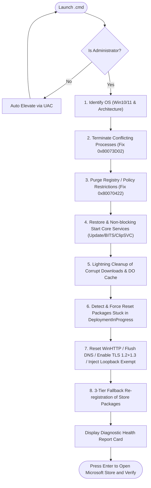
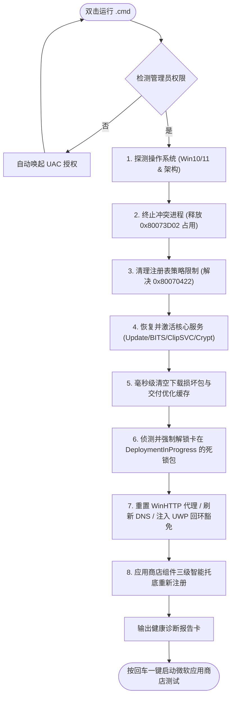

# 🛠️ Microsoft Store Pro Auto-Repair Tool
### 微软应用商店全能修复工具 (Windows 10 / 11)

An enterprise-grade, lightning-fast, zero-resident, cross-generational auto-repair tool for Microsoft Store.  
一款针对 Windows 应用商店“无法更新 / 下载卡死 / 错误代码 / 依赖损坏”的企业级跨版本智能自适应深度修复工具。

[-0078D6?style=for-the-badge&logo=windows&logoColor=white)](https://github.com/1837620622/MicrosoftStoreRepairTool)

 

**[English](#-english) | [简体中文](#-简体中文)**

---

# 🌐 English

### 🏷️ GitHub Topics
`microsoft-store` · `windows-store` · `windows-11` · `windows-10` · `uwp` · `troubleshooting` · `loopback-exempt` · `windows-update` · `powershell` · `windows-tools` · `automation` · `batch`

---

## 📌 Problem Statement

Users frequently encounter frustrating issues with the Microsoft Store on Windows:
- ❌ Downloads permanently stuck at **`0%`**, **`Pending`**, or **`Retrying`**;
- ❌ Installation/update errors with cryptic codes (e.g., `0x80073CF0`, `0x80073D02`, `0x803F8001`, `0x80131500`);
- ❌ Page loading failures when local proxy/VPN software is enabled (due to UWP AppContainer network loopback isolation);
- ❌ Conventional solutions force users to run 30+ minute full-system scans (`DISM /RestoreHealth` / `SFC /scannow`) and reboot, yet often fail to solve the actual root cause;
- ❌ Poorly-designed community scripts often leave persistent scheduled background tasks that wake up every 30 minutes, continuously eating CPU/RAM.

**This project was created to solve these exact pain points once and for all.**

---

## 🌟 Key Features

- ⚡ **Lightning Fast (10 ~ 15 Seconds)**: Accurately targets Store deployment queues and dependency chains. No wasteful full-disk scans.
- 🖥️ **Cross-Generational Auto-Adaptive**:
  - Automatically identifies Windows 10 (21H2/22H2, etc.) and Windows 11 (22H2/23H2/24H2, etc.);
  - Automatically detects system architecture (AMD64 / ARM64);
  - Dynamically applies the optimal AppX reset and service recovery strategies based on the operating environment.
- 🧹 **Zero Background Resident**: Automatically unregisters legacy 30-minute polling tasks. Run on demand, exit cleanly, zero background footprint.
- 🛡️ **Deployment Conflict Elimination (Fixes 0x80073D02)**: Completely terminates lingering processes (`WinStore.App`, `winget`, `AppInstaller`, `StorePurchaseApp`, `WWAHost`) to unlock the installer pipeline.
- 🔓 **Group Policy & Registry Unblock (Fixes 0x80070422)**: Automatically purges malicious or leftover registry policies (`RemoveWindowsStore`, `DisableStoreApps`).
- 🌐 **Dual Network Stack Calibration & UWP Loopback Exemption**:
  - Resets WinHTTP proxy to direct access and flushes DNS cache;
  - Enforces modern security protocols (**TLS 1.2 / TLS 1.3**);
  - Injects native `CheckNetIsolation` loopback exemption for Microsoft Store, completely resolving proxy conflicts (`0x80131500` / `0x80072EFD`).
- 🧩 **3-Tier Fallback Registration Engine**:
  - `Tier 1`: Re-registers in the current user context;
  - `Tier 2`: Scans `WindowsApps` physical directory manifests if user registration was wiped;
  - `Tier 3`: Triggers native `wsreset.exe -i` for cloud retrieval if core binaries are missing.

---

## 🔄 Workflow

---

## 🎯 Error Code Quick Reference

| Error Code | Trigger Scenario | Root Cause | Solution by this Tool |
| :--- | :--- | :--- | :--- |
| **0x80073CF0 / 0x80070002** | Download stuck at 0% or interrupted | Corrupt temporary download files or unreleased file locks | Safely empties `SoftwareDistribution\Download` using low-level non-blocking APIs |
| **0x80073D02** | Fails when re-registering Store packages | `AppInstaller` or Store background workers are held by Windows | Thoroughly terminates the entire conflicting process tree |
| **0x803F8001** | App license missing or validation error | Client License Service (`ClipSVC`) stopped or disabled | Corrects startup type to Manual/Auto and starts `ClipSVC` instantly |
| **0x80070422** | Service is disabled; unable to install | Windows Update or Store install services disabled by policy | Removes policy blocks and forces service startup types to Auto |
| **0x80131500 / 0x80072EFD** | Store connection timeout / Retry page | Local proxy software running; UWP lacks loopback permission | Injects `CheckNetIsolation` exemption, resets proxy & ensures TLS 1.2/1.3 |
| **0x8024402C** | Network connection timeout | DNS cache corruption or invalid WinHTTP proxy leftovers | Resets WinHTTP network stack to direct and flushes DNS |

---

## 🚀 How to Use

### Method 1: Local Double-Click
1. Double-click **`一键修复微软商店.cmd`** on your Desktop or folder;
2. Click **"Yes"** in the User Account Control (UAC) prompt;
3. The script will perform automated self-adaptive repair within **10 ~ 15 seconds**;
4. Press **Enter** to open the Microsoft Store and click "Get updates" to verify.

### Method 2: Portable Deployment (Fix Other PCs)
This tool is completely self-contained in a single `.cmd` file. Copy `一键修复微软商店.cmd` to a USB drive or send it to any malfunctioning computer, then double-click to run.

---

## ⚙️ Technical Architecture

- **Launcher Shell**: Written in 100% pure ASCII batch script (`.cmd`) with native UAC auto-elevation. Completely immune to `cmd.exe` multi-byte code page encoding corruption and cursor-doubling glitches.
- **Core Engine**: Base64-encoded safe PowerShell script block with asynchronous error handling (`try-catch`) and non-blocking timeout mechanisms, guaranteeing smooth execution across all Windows editions.

---

## ❓ Frequently Asked Questions (FAQ)

<b>Q1: Why does this repair take only ~10 seconds while tutorials take 30+ minutes?</b>

Typical online tutorials recommend running full SFC and DISM scans, which hash every single file on the OS drive. Store issues are almost exclusively caused by deployment queue deadlocks, unreleased file locks, UWP loopback isolation, or stopped license services. This tool directly fixes the root causes without wasting time on unrelated files.

<b>Q2: Will running this tool affect my installed applications or personal files?</b>

No. The tool only clears transient store download queues, removes damaged temporary cache packages, and restores default Windows service configurations. Personal files, credentials, and installed programs remain completely untouched.

<b>Q3: I use proxy/VPN software. Will it conflict after running this tool?</b>

Not at all. This tool explicitly injects UWP Loopback Network Exemptions (`CheckNetIsolation`), allowing Microsoft Store to coexist seamlessly with local proxy software and eliminating the `0x80131500` error.

 

---
---

# 🇨🇳 简体中文

### 🏷️ 项目标签 (Topics)
`microsoft-store` · `windows-store` · `windows-11` · `windows-10` · `uwp` · `troubleshooting` · `loopback-exempt` · `windows-update` · `powershell` · `windows-tools` · `automation` · `batch`

---

## 📌 痛点背景

在日常使用 Windows 系统时，微软应用商店经常出现以下令人困扰的问题：
- ❌ 应用更新永久卡在 **`0%`**、**`正在挂起`** 或 **`正在重试`**；
- ❌ 点击安装或更新频繁弹窗报错（如 `0x80073CF0`、`0x80073D02`、`0x803F8001`、`0x80131500` 等）；
- ❌ 开启了代理/网络加速软件后，商店页面报错打不开（UWP 沙盒回环网络隔离导致）；
- ❌ 传统解决方案通常需要用户执行耗时 30 分钟以上的 `DISM /RestoreHealth` 或 `SFC /scannow`，且必须重启电脑，费时费力却往往无法解决问题；
- ❌ 部分第三方修复脚本粗暴常驻后台定时轮询（如每30分钟自动唤醒一次），持续侵占系统 CPU 和内存。

**本项目正是为彻底解决上述顽疾而生。**

---

## 🌟 核心特性

- ⚡ **闪电修复（10 ~ 15 秒）**：精准定位应用商店下载队列与依赖链，秒级清空损坏缓存，不跑无意义的全盘扫描。
- 🖥️ **跨代智能自适应**：
  - 自动检测并识别 Windows 10（21H2/22H2 等）与 Windows 11（22H2/23H2/24H2 等）；
  - 自动识别硬件架构（AMD64 / ARM64）；
  - 根据环境动态切换最匹配的 AppX 重置与服务唤起策略。
- 🧹 **零后台常驻与垃圾清理**：彻底注销任何遗留的定时轮询任务，即开即修，修完即走，绝不驻留系统后台。
- 🛡️ **部署占用冲突根治（攻克 0x80073D02）**：全量释放 `WinStore.App`、`winget`、`AppInstaller`、`StorePurchaseApp`、`WWAHost` 等应用占用锁，防止部署操作被 Windows 拒绝。
- 🔓 **组策略与注册表自动解封（攻克 0x80070422）**：自动清理恶意或第三方软件残留的 `RemoveWindowsStore`、`DisableStoreApps` 等策略限制。
- 🌐 **双重网络协议校准 + UWP 回环网络豁免**：
  - 重置 WinHTTP 底层网络代理为直接连接；
  - 强行启用现代加密协议 **TLS 1.2 / TLS 1.3**；
  - 自动通过 `CheckNetIsolation` 为微软商店注入**本地网络回环免除**（彻底解决代理客户端导致的 `0x80131500` / `0x80072EFD`）。
- 🧩 **三级智能托底注册机制**：
  - `一级`：当前用户环境精准重注册；
  - `二级`：跨目录物理扫描 `WindowsApps` 实体清单补齐；
  - `三级`：调用系统原生 `wsreset.exe -i` 在线拉回缺失组件（即使商店被误删也能复原）。

---

## 🔄 工作流程

---

## 🎯 常见错误代码与病灶解析

| 错误代码 | 典型触发场景 | 根本病灶原因 | 本工具针对性解决措施 |
| :--- | :--- | :--- | :--- |
| **0x80073CF0** / **0x80070002** | 下载进度卡在 0% 或报错中断 | 临时下载目录文件损坏、文件锁未释放 | 安全清空 `SoftwareDistribution\Download` 损坏包并重建目录 |
| **0x80073D02** | 重新注册或更新商店自身时失败 | `AppInstaller` / 商店后台进程被 Windows 判定为“使用中” | 全量检索并强制终止关联进程树，释放安装器通道 |
| **0x803F8001** | 应用提示许可证丢失或无法更新 | 客户端许可证服务 `ClipSVC` 异常或未运行 | 自动将 `ClipSVC` 设置为受控模式并即时唤醒 |
| **0x80070422** | 提示服务已被禁用，无法安装 | 注册表策略阻断或更新核心服务被禁用 | 自动移除策略阻断键，并强制纠正服务启动类型为自动 |
| **0x80131500** / **0x80072EFD** | 商店页面打不开、重试页面 | 开启了代理客户端，UWP 缺乏本机回环访问权限 | 注入 `CheckNetIsolation` 本地回环豁免，重置代理并激活 TLS 1.2/1.3 |
| **0x8024402C** | 商店报网络连接超时 | DNS 污染或底层 WinHTTP 代理残留 | 执行底层网络协议栈复位并强制刷新系统 DNS 解析缓存 |

---

## 🚀 使用指南

### 1. 本机双击使用
1. 直接双击运行桌面上或目录下的 **`一键修复微软商店.cmd`**；
2. 在弹出的“用户账户控制 (UAC)”窗口中点击**“是”**；
3. 控制台将在 **10 ~ 15 秒**内全自动完成系统检测与深度修复；
4. 修复完成后根据提示按**回车键**，将自动打开微软应用商店进行下载测试。

### 2. 便携使用（拯救其他故障电脑）
本工具为**完全单文件绿色版**，无需安装任何额外依赖，可直接将 `一键修复微软商店.cmd` 拷贝至 U 盘或通过聊天工具发送至任意有问题的电脑上，双击运行即可。

---

## ⚙️ 技术架构

- **外壳引导层**：采用 100% 纯 ASCII 语法编写的 `.cmd` 引导器，内置原生 UAC 自提权机制，彻底避免 `cmd.exe` 在多语言代码页环境下的编码与特殊字符转义陷阱，解决光标步长错位乱码。
- **核心执行层**：采用 Base64 打包的安全 PowerShell 逻辑，具备完善的异步异常捕获（`try-catch`）与超时防卡死设计，保证各环节在任何系统上均能顺畅退出。

---

## ❓ 常见问题 (FAQ)

<b>Q1: 为什么修复只需要十几秒，而网上的教程需要半小时甚至重启？</b>

网上常见方案通常让用户运行 SFC 全盘扫描和 DISM 镜像修复，这两个命令会对整个操作系统所有系统文件进行哈希比对，耗时极长。而微软商店故障 99% 集中在“下载队列死锁”、“临时锁未释放”、“网络回环隔离”和“许可证服务未启动”，本工具精准切除病灶，因此仅需十几秒。

<b>Q2: 修复会影响我电脑里已经安装好的软件或个人文件吗？</b>

绝对不会。本工具仅重置微软商店的临时更新队列、清理临时下载安装包以及恢复系统标准服务配置，绝不触碰任何用户数据与个人文件。

<b>Q3: 我开启了网络加速/代理工具，修复后会不会冲突？</b>

不会。本工具特别加入了 UWP 本地回环网络豁免（Loopback Exempt），修复后微软商店不仅能直连，更能与各类代理软件完美共存，彻底告别 0x80131500 页面无法加载的问题。

---

## 📄 开源许可证

本项目基于 [MIT License](LICENSE) 许可开源。欢迎 Star、Fork 与提 Issue！